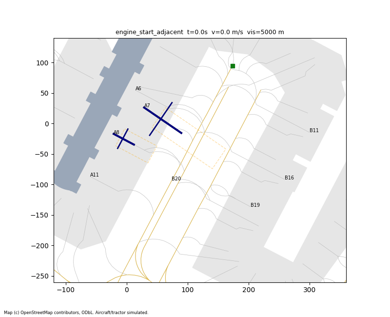

# AirGuard

**AI is writing the code that drives robots next to airplanes. AirGuard proves it's safe before it runs.**

Driverless baggage tractors already run next to aircraft at Singapore Changi (T1<->T4, since Jan 2026)
and Dubai DWC (dnata), with trials at Schiphol and Stuttgart. Their driving software changes often, more
and more of it written by AI, and nobody independently proves an update is safe before it is deployed.
AirGuard is that gate. Built for AIE Code Summit 2026, track "Trust but Verify".



## How it works

| Role | Who | Job |
|---|---|---|
| Implementer | **Meta Muse Spark** (`META_API_KEY`) | writes controller updates from a change request; describes the violation frame (vision) |
| Verifier | **SubQ** `subq-preview` (`SUBQ_API_KEY`) | long-horizon red team: reads the full FAA AC, the real SFO map, the whole repo and **all previous simulation traces at every 0.1 s step** each round, then designs harder scenarios. It never sees the implementer's prompt, comments or reasoning. |
| Judge | deterministic Python (`checks.py`) | simulates, measures, and decides PASS/BLOCK. No LLM ever decides. |

`verify.py` runs the loop:
1. **Round 0, blind spec.** SubQ gets the FAA text, rules, map, aircraft data, the approved controller and the sim/check source, but NOT the candidate. It returns invariant parameters and adversarial scenarios. Both are schema-validated, and unknown rule types or fields are rejected.
2. Every scenario (6 built-in floor scenarios + SubQ's) runs against the candidate. `checks.py` scores them.
3. **Rounds 1..N, red team.** The complete traces of the previous round are appended to the same conversation (never summarised), together with the comment-stripped candidate diff. SubQ targets the near-misses. The loop stops on a violation or when SubQ has nothing harder. Context size per round is logged.
4. **Vision.** The PNG frame at the first violation goes to Meta for a plain-English hazard description.
5. **Verdict** goes to `verdicts/<candidate>_<ts>.json`: every violation with rule id, FAA citation, scenario, t, x/y, measured vs limit, plus file, prompt and data hashes and a `verdict_hash`. The same inputs and LLM cache give an identical `verdict_hash`.
6. **Rollback.** `deployed.json` points at the last approved controller and keeps a history. PASS promotes. BLOCK keeps the current controller, and if the blocked file was the deployed one, AirGuard reverts.

Anti-gaming: the floor invariants always apply, and LLM parameters can only *tighten* them (`checks.tighten`). Scenarios and seeds come from the verifier, not the candidate. A tractor that never moves fails `mission_complete`. Meta-written code is AST-sanitised (only `math`/`sim` imports, no `open`/`eval`/dunders) before it runs.

## Large-scale stress data, cross-checked with SubQ

`stress.py` generates thousands of seeded random scenarios across all 8 real SFO stands, 4 aircraft
types, engine starts, pushbacks, fog, GPS noise, crew and debris (1000 scenarios is about 900k simulation steps, or
25 simulated hours per controller, in about 1 minute on 8 cores). Random scenarios are sometimes impossible for any
controller, so the gate scores them **differentially**: `verify.py --fuzz N` runs the candidate and the
approved controller on the same N scenarios and BLOCKs if the candidate fails more of them
(`stress_noninferiority`). The full per-scenario result table and every regression scenario then go
into **SubQ's red-team context**, so SubQ targets the exact weak spots the large data exposed.

| 1000 seeded scenarios | scenarios with violations | regressions vs v1 |
|---|---|---|
| tug_v1 (approved) | 119 | - |
| tug_v2_ai (seeded faulty) | ~400 | ~270 -> BLOCK |
| tug_v3_fixed | 106 | 16 (non-inferior -> listed for SubQ) |

The stress data found real bugs that the 6 hand-written scenarios missed. One was that a tractor waiting for a
pushback could be hit by the pushing aircraft. Another was that a tractor could stop *inside* one jet-blast zone
while waiting for the next one. v3 was fixed: it backs off from a pushing aircraft and never stops inside a live blast zone.

## 3D replay viewer (three.js)

Every `verify.py` run writes `out/replay_<candidate>.js`. Open
`viewer.html#out/replay_tug_v2_ai.js` in a browser (works from `file://`, no server). It replays
every scenario of every round in 3D on the real SFO apron: aircraft with blinking beacons, live
jet-blast zones, pushback, crew, debris, fog, and red pillars at each violation. The side panel shows
the verdict, the **SubQ round log (context size and tokens per round)**, the stress comparison, **model
usage metrics** and the violations with FAA citations.

## Alerts on BLOCK

`alert.py` places a **Twilio voice call** (text-to-speech, plain REST through `requests`) to `ALERT_TO`
from `TWILIO_FROM`. The call says which update was blocked, which rule (with the FAA citation), the gate, and
that the approved controller stayed deployed. If Twilio is not configured it falls back to Telegram
(`TELEGRAM_BOT_TOKEN`, `TELEGRAM_CHAT_ID`). If nothing is configured it logs "alert skipped". `--no-alert`
disables it.

## Model usage metrics

Every SubQ and Meta call records its prompt and completion tokens, prompt characters, latency and whether it was a cache hit.
`verify.py` prints totals per model, stores them in the verdict (`usage`, outside `verdict_hash`),
and the viewer shows them.

## Run it

```
py -m pip install requests matplotlib
py selfcheck.py                              # offline: v1 PASS, v2 BLOCK (jet blast + fog), v3 PASS, stand-still BLOCK, reproducible
py verify.py tugs/tug_v2_ai.py --gif         # live SubQ red team (needs SUBQ_API_KEY), --offline = cache only
py baseline.py tugs/tug_v2_ai.py             # diff-only reviewer for contrast
py meta_implement.py --request "make the route 20% faster" --out tugs/tug_meta_1.py   # needs META_API_KEY
py verify.py tugs/tug_meta_1.py
py stress.py --n 1000 tugs/tug_v1.py tugs/tug_v2_ai.py tugs/tug_v3_fixed.py   # large-data comparison
py verify.py tugs/tug_v3_fixed.py --fuzz 1000   # gate + stress data fed to SubQ
# then open viewer.html#out/replay_tug_v3_fixed.js
```
Put keys in `.env` (copy `.env.example`; `.env` is gitignored).
Optional env: `SUBQ_MODEL`, `SUBQ_URL`, `META_MODEL` (default `muse-spark-1.2`), `META_URL`. Keys are read from env and never printed or stored. LLM responses are recorded in `cache/` so runs replay offline.

## What is real and what is simulated

| Thing | Status | Source |
|---|---|---|
| SFO apron geometry: stands A6/A7/A8/A11, B11/B16/B19/B20, taxilane M5, aprons, terminals | **real** | `data/sfo_osm.json`, OpenStreetMap Overpass, bbox 37.605,-122.400,37.630,-122.365. (c) OpenStreetMap contributors, ODbL |
| Rules and citations | **real** | FAA AC 150/5210-20A *Ground Vehicle Operations* (2015, public domain), `data/faa_ac_150_5210_20A.{pdf,txt}` |
| Aircraft wingspan / length | **real** | FAA Aircraft Characteristics Database |
| Engine positions, jet-blast lengths | **approximate** | read off manufacturer airport-planning docs, not certified values |
| Speed limits, clearance distances | **example values** | the AC says the airport operator sets speed limits (Ch. 3 item 5); see `rules/ground_ops.md` |
| Tractor route | real M5 polyline + simulated door point | `sim.route_to` |
| Aircraft states, crew, debris, fog, GPS noise, tractor dynamics | **simulated** | `sim.py`, seeded, dt = 0.1 s |

## Candidates: which were hand-seeded and which came from Meta

- `tugs/tug_v1.py`: hand-written approved baseline (5 m/s, yields to beacons, jet blast, pushback, people; slows in fog).
- `tugs/tug_v2_ai.py`: **hand-seeded** to simulate a bad AI "optimisation": +20% speed, beacon/engine check removed, no fog slowdown. **Not** written by Meta.
- `tugs/tug_v3_fixed.py`: **hand-seeded** fix: +20% speed with all checks kept and a longer lookahead. About 13% faster than v1 on the nominal run.
- `tugs/tug_meta_*.py`: produced live by Meta through `meta_implement.py`. Each file header records the model, the request and the cache hash.

## Built today

All code in this repo (`sim.py`, `checks.py`, `verify.py`, `llm.py`, `meta_implement.py`, `baseline.py`,
`selfcheck.py`, `stress.py`, `alert.py`, `viewer.html`, `tugs/`, `rules/`, `data/aircraft.json`) was written during the hackathon.

## Known limits

- 2D point-mass tractor, a simplified aircraft footprint (fuselage + wing lines) and a rectangular jet-blast zone.
- `jet_blast_zone`: being inside the zone while engines run or the aircraft pushes back is a violation, and so is *entering* it once the beacon has been on for at least 3 s (`BEACON_REACTION_S`, an example reaction-time allowance). Being caught inside when a beacon first lights is not a violation by itself, but you must get out before engine start.
- The SubQ and Meta request formats follow the OpenAI chat-completions shape. Override the URLs and models through env if the real APIs differ.
- Full per-step traces make round N+1 contexts large (hundreds of thousands of characters). This is deliberate: it is the long-horizon test.
